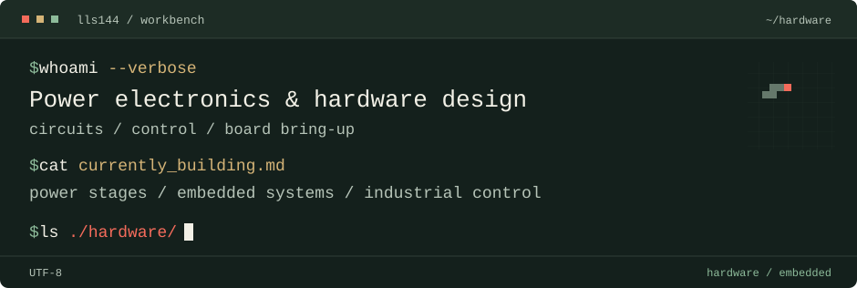

<picture>
  <source media="(max-width: 640px)" srcset="assets/terminal-narrow.svg">
  
</picture>

<picture></picture> <strong>hardware/</strong> &nbsp; 4 projects

├─ **[Supercapacitor Controller](projects/supercapacitor.md)** 双向四开关功率级、电流控制链与板卡装配联调。 &nbsp;&nbsp;&nbsp;&nbsp;&nbsp;&nbsp;RoboMaster · FSBB · STM32F334 · CAN

├─ **[Wireless Power Transfer](projects/wireless-power.md)** 谐振补偿、互感线圈及发射/接收功率级迭代。 &nbsp;&nbsp;&nbsp;&nbsp;&nbsp;&nbsp;LCC-S / S-S · Simulink · PCB

├─ **[Bidirectional DC/DC](projects/bidirectional-dcdc.md)** 双向同步 Boost 初设中的控制与电压、电流采样电路。 &nbsp;&nbsp;&nbsp;&nbsp;&nbsp;&nbsp;STM32G474 · 同步 Boost · V/I 采样

└─ **[Solar MPPT](projects/solar-mppt.md)** LT8705 / CVT 方案、储能联调与三个输出观测点。 &nbsp;&nbsp;&nbsp;&nbsp;&nbsp;&nbsp;LT8705 · CVT · Buck-Boost

#### [Embedded & System Integration](systems.md)

视觉分拣控制系统：OpenCV 视觉事件连接控制器、FIFO / FSM 与 HMI，分别验证 PLC 和 Linux 后端。

[视觉 / PLC 集成](https://github.com/lls144/huiyan-shizhu) · [i.MX6ULL / Linux 控制与 HMI](https://github.com/lls144/huiyan-shizhu-imx6ull) · [工程记录](projects/embedded-linux-vision.md)

#### Contributions.exe

<picture>
  <source media="(prefers-color-scheme: dark)" srcset="https://raw.githubusercontent.com/lls144/lls144/output/pacman-contribution-graph-dark.svg">
  <source media="(prefers-color-scheme: light)" srcset="https://raw.githubusercontent.com/lls144/lls144/output/pacman-contribution-graph.svg">
  
</picture>

<a href="https://raw.githubusercontent.com/lls144/lls144/output/pacman-contribution-graph.svg">查看原尺寸</a>

---

▪ Off-duty &nbsp; Nintendo · TYPE-MOON · Minecraft
