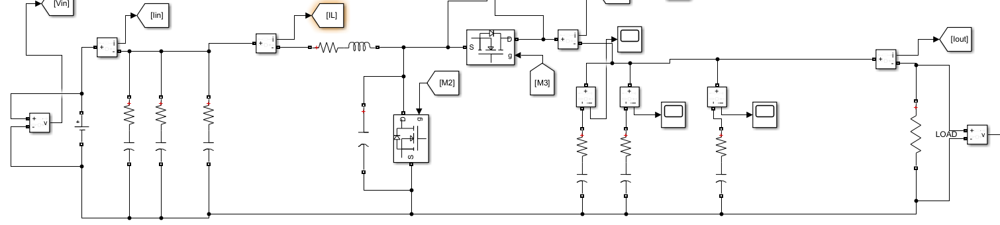

[← hardware/](../README.md)

# Bidirectional DC/DC

面向双向能量交换的竞赛初设方案。我的工作集中在**控制电路与电压、电流采样电路设计**。

`STM32G474` · `同步 Boost / 反向 Buck` · `V/I 采样` · `PI`

## 从两个低压端接入共同母线

方案以电感和上下开关构成双向同步功率级：向高压侧输送能量时工作在 Boost 方向，反向时按 Buck 方向处理。初设包含两个独立低压端、共同高压母线和模块间均流思路。

*初设报告的 Simulink 功率级模型局部，用于展示拓扑和信号关系；这是仿真模型，不是样机测试波形。*

| 初设项目 | 设计范围 / 目标 |
|---|---|
| 低压侧 / 高压侧 | 75–240 V / 400 V |
| 单模块功率 | 500 W |
| 开关频率 | 指标 200 kHz；部分器件计算采用 100 kHz |
| 效率 | 目标 95% |
| 均流 / 响应 | 目标 ±5% / 200 μs |

## 控制和采样接口

控制器采用 STM32G474 方案。电压、电流反馈经过模拟前端送入 ADC，PI 输出进入 PWM 调制；报告同时给出电压调节与平均电流均流框图。个人职责是控制和采样电路，功率级、均流和软开关的整套方案属于团队初设。

| 设计位置 | 需要解决的问题 | 报告中的器件 / 依据 |
|---|---|---|
| 电流采样 | 分流电阻压降、双向电流偏置、增益与 ADC 范围 | INA240A1 方案 |
| 电压调理 | 高压分压比例、运放输入输出范围、RC 与建立时间 | OPA2180 方案 |
| PWM 与驱动 | 逻辑接口、互补时序、死区和栅极回路 | STM32G474 / IRS2186S 方案 |

器件名称是初设选型线索，最终装板型号需由终版 BOM 确认。采样链路的误差来自分压/分流器、放大器和 ADC，需要一起预算；单看 ADC 位数不能得到整机测量精度。

## 复核初设时，先消除计算口径冲突

- **频率口径：** 指标为 200 kHz，电感计算却代入 100 kHz。需要先统一频率，再重算纹波和损耗，不能把其中一个值当成已测结果。
- **导通模式：** 报告给出 330 μH，并有模式表述不一致。按输入、负载与频率核对临界电感，比仅凭“电感较大”判断 DCM 更可靠。
- **死区：** 互补信号经过相同延时不会自动产生死区。需要分别检查开通/关断边沿与实际 Gate 波形。

这些是设计复核项，不是已经完成的样机改板记录。现有进度证据支持拓扑与仿真阶段，器件选择、PCB 与程序还有后续工作。

设计资料与后续验证

当前留存为初设报告与其中的模型/计算图，缺少可归属本项目的终版 EDA、PCB、BOM、原生模型和实机测量。下一步应闭合频率与器件版本，评审采样/驱动原理图，再记录板卡上电、标定和双向工况测试。目标表中的数字不作为实测性能。

[STM32G474RE 文档](https://www.st.com/en/microcontrollers-microprocessors/stm32g474re.html) · [INA240](https://www.ti.com/product/INA240) · [OPA2180](https://www.ti.com/product/OPA2180) · [图片说明](../assets/evidence/README.md)

[Next → Solar MPPT](solar-mppt.md)
