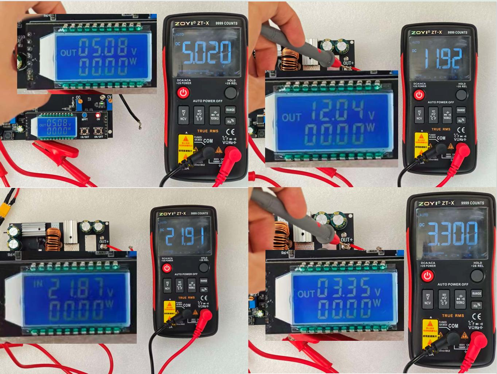
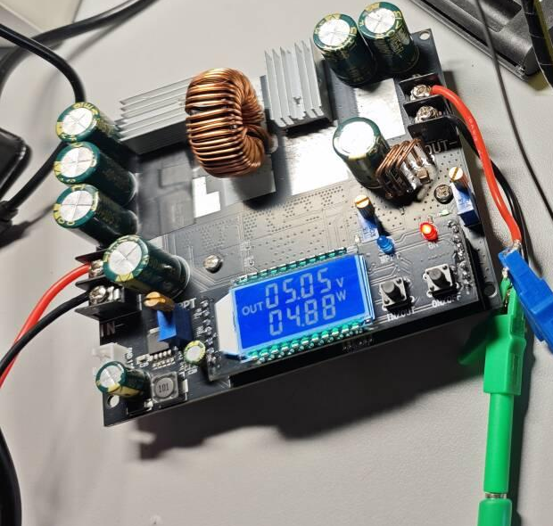

[← hardware/](../README.md)

# Solar MPPT

以 LT8705 四开关 Buck-Boost 为硬件主线，用 CVT 恒压跟踪思路选择光伏工作电压，并开展功率模块与储能联调。

`LT8705` · `CVT` · `Simulink` · `储能联调`

## 方案、硬件和测试由一条主线推进

我作为项目负责人和主要技术实施者，推进方案、硬件设计、仿真、功率板迭代与测试结项，储能侧涉及 18650 与被动均衡超级电容组。

`光伏输入 → 四开关 Buck-Boost → 输出 / 储能`

CVT 的控制对象是光伏输入工作电压。它用选定的电压目标维持工作点；输出端稳压和光伏功率跟踪是不同的验证问题。

## 两个控制阶段，分别看依据

| 材料阶段 | 工作内容 | 该怎样理解 |
|---|---|---|
| 仿真与数字控制探索 | Simulink、ADC/PWM、显示与控制链路 | 用于模型和控制过程分析；留存图中有单开关 Buck 模型 |
| 最终报告硬件主线 | LT8705、四开关 Buck-Boost、硬件 CVT | 按模拟控制器与硬件反馈链讲解，不能套用其他项目的 STM32 固件 |

四开关结构用于覆盖输入高于、低于输出的工作区间。设计时需要把输入电压控制目标、输出电压限制和电流限制分开检查，避免把限流或输出调节动作误认为已经完成最大功率跟踪。

## 三个设定点的真实对照

*留存测试照片：同一组资料中的模块显示与万用表读数。拼图还含其他工作点，下表仅列已核对的 3.3 / 5 / 12 V 三个设定点。*

| 输出设定 | 模块显示 | 万用表读数 | 两者绝对差 |
|---|---|---|---|
| 3.3 V | 3.35 V | 3.300 V | 0.050 V |
| 5 V | 5.08 V | 5.020 V | 0.060 V |
| 12 V | 12.04 V | 11.92 V | 0.120 V |

最大模块显示与万用表绝对差为 **0.12 V**。这是三个观测点，不是三路同时输出。照片保留了读数，但没有完整的输入/负载条件与仪表校准信息，因此只用于展示这组对照。

## 功率模块与储能联调

*项目留存的测试模块实物。散热器遮挡主芯片，照片用于说明实验装配，不单凭外观认定芯片与板卡版本。*

功率板调试与储能联调需要把供电、限流、输出设定和储能端状态连起来看。现有材料能够支撑方案迭代与上述观测点；进一步评估 CVT，应同步记录光伏端电压、电流和功率，而不是只看输出电压是否接近设定值。

资料对应关系与下一步

旧报告部分 PCB、ADC 与软件图片来自超级电容上下文，未作为本页 MPPT 证据使用。最终硬件的原生 EDA/BOM、控制器版本与模型对应仍需补齐；下一轮测试应记录输入、负载、温度、仪器和测量时间，并区分转换效率与跟踪效率。

三个观测点不外推为全工况精度或任一种效率指标。项目负责人职责按已核对的参与记录整理。

[LT8705 官方资料](https://www.analog.com/en/products/lt8705.html) · [图片说明](../assets/evidence/README.md) · [返回 hardware/](../README.md)
