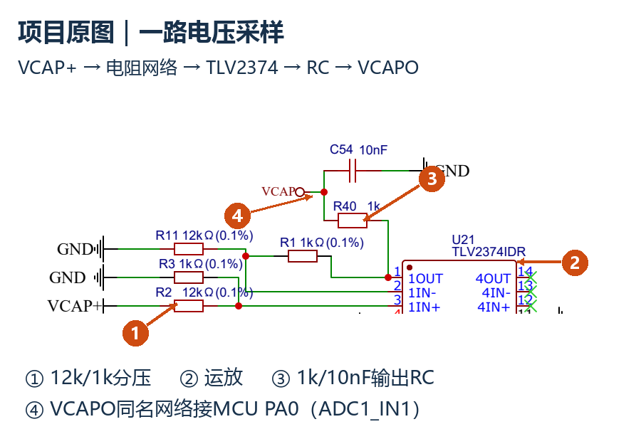

[← hardware/](../README.md)

# Supercapacitor Controller

RoboMaster 双向四开关 Buck-Boost 超级电容控制器。直流母线与电容储能端之间的能流由功率指令调节。

`FSBB` · `STM32F334` · `HRTIM / ADC / DMA` · `CAN`

## 从板卡到整机

我参与控制板与功率板焊接、被动均衡超级电容组搭建，以及整机联调，使用 VOFA+ 观察控制量。电路和 V4.2 固件由团队协作实现；这里沿着实际实现说明控制链，再给出资料复核中需要处理的版本与时序问题。

*通用拓扑示意：两个半桥中点经电感连接，两端正母线独立、负端共地。图中端口字母不对应固件的 A/B 命名，以下用物理位置区分。*

## 功率给定怎样变成 PWM

1. CAN 接收目标功率，用母线侧电压换算支路电流目标。
2. STM32F334 的 HRTIM 触发 ADC 六通道顺序转换，循环 DMA 搬运原始采样。
3. 定时任务完成标定换算与滤波，母线侧支路电流进入 PI。
4. PI 经限幅调节母线侧半桥；另一半桥保持固定占空比例。

受控量是**母线侧支路电流**。功率目标随电压换算成电流目标；不能直接把这条支路当作电感电流，也不能把当前双桥策略等同于完整三模式调度。

*控制板原理图局部：电阻网络 → TLV2374 → 输出 RC → ADC。彩色编号是后加的读图标注，不是测试测点记录。*

## 50 kHz 与 194 Hz 分别发生在哪里

| 环节 | 配置与计算依据 | 含义 |
|---|---|---|
| HRTIM PWM / 控制事件 | 128 MHz × 4 ÷ 10240 = **50 kHz** | 开关和控制计算的名义事件频率 |
| 处理后反馈 | 64 MHz ÷ (33 × 10001) ≈ **193.92 Hz** | TIM3 约每 5.16 ms 更新标定、滤波后的反馈 |
| CAN | 32 MHz ÷ (4 × 8) = **1 Mbps** | 名义总线速率 |

控制中断会多次使用同一份处理后反馈，所以 50 kHz 不能写成有效反馈刷新率或闭环带宽。上述值来自配置复核与时钟计算，实际延迟需用仪器测量。

ADC 触发点随比较值安排在高侧导通区间中部。这个安排有助于避开开关边沿，但小占空比时窗口会缩短，六路顺序采样也有先后延迟。滤波改善读数稳定性，同时占用控制链的相位裕量；采样、处理和 PWM 更新需要放在同一条时间线上检查。

## 版本复核留下的三项工作

| 发现 | 对设计和联调的影响 | 处理方向 |
|---|---|---|
| 原理图与 BOM 的 INA240A1/A2、5/4 mΩ 字段不一致 | 电流换算增益可能不同 | 以实物丝印、装配记录确定版本，再做零点和增益标定 |
| 定时中断中阻塞发送 VOFA+ 数据 | 观察接口可能增加反馈处理延迟 | 测量执行时间，评估发送缓冲与异步串口 |
| CAN 超时后清零目标、压低占空比 | 停止给定与功率级安全态是两个问题 | 同步观察目标值、栅极和支路电流，单独验收失联行为 |

这些是对留存资料的复核结果，处理方向尚未作为新一轮实机验证完成。约 0.5 s 超时清零属于软件逻辑；当前 HRTIM Fault 配置和温度采集记录不足以支持逐周期硬件过流、完整过温保护的结论。

资料范围与待补证据

现有依据为参与记录、控制板原理图/BOM/PCB 导出和团队 V4.2 固件。完整功率板实装、PWM/栅极原始波形、CAN 抓包、标定记录与带工况的功率/温升测试仍需补齐。后续优先核对板卡版本和采样换算，再做反馈时序、功率阶跃和失联安全态验证。

本页不列未经测量的效率、峰值电流或控制带宽。源码未取得独立公开入口，技术图只展示筛选后的局部。

[STM32F334C8 文档](https://www.st.com/en/microcontrollers-microprocessors/stm32f334c8.html) · [INA240 文档](https://www.ti.com/product/INA240) · [图片说明](../assets/evidence/README.md)

[Next → Wireless Power Transfer](wireless-power.md)
