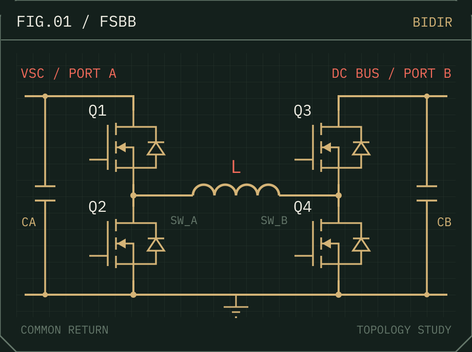

[← Project Select](../README.md)

# Supercapacitor Controller

RoboMaster 双向四开关 Buck-Boost 超级电容控制器。

## 两个半桥，一个电感

Q1 / Q2 与 Q3 / Q4 分别构成两个半桥，电感接在两个开关节点之间。两端正母线各自独立，负端共地；MOSFET 沟道允许电流双向流动，控制器调节两端的开关时序来控制能流。

这是通用拓扑重绘，省略驱动、采样和保护，不是完整功率板实装图。

## 从功率指令到 PWM

队内 V4.2 的控制链可以沿着下面的顺序阅读：

1. CAN 接收目标功率，按实时母线电压换算目标电流。
2. STM32F334 的 HRTIM 触发 ADC 多通道序列采样，DMA 搬运结果。
3. 电压、电流经过标定与数字滤波，进入电流 PI。
4. PI 输出调节 PWM，驱动双半桥。

名义 **50 kHz PWM** 和 **1 Mbps CAN** 是代码配置。约 0.5 s 未收到指令后清零目标，不等于硬件关断；PWM 频率也不等于有效反馈刷新率。

## 从板子到整机

实际参与的是控制板与功率板焊接、被动均衡超级电容组搭建，以及整机联调。调试使用 VOFA+。上面的控制链属于队内实现，不表示全部硬件和固件都由个人独立完成。

现有资料不足以确认效率、峰值电流、完整三模式无缝切换或逐周期硬件保护，因此这里不列这些性能结论。

---

[Next → Wireless Power Transfer](wireless-power.md) · [返回选择菜单](../README.md)
