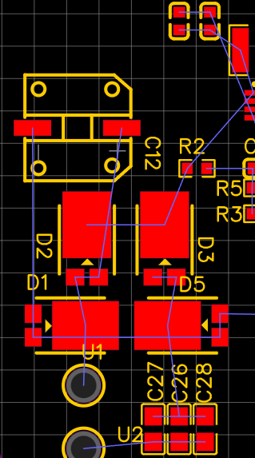

[← hardware/](../README.md)

# Wireless Power Transfer

从补偿网络计算到 Tx / Rx PCB，再到驱动、线圈和功率级联调的无线充电项目。

`LCC-S / S-S` · `NP0 / C0G` · `互感线圈` · `PCB`

## 先把功率链分清

`直流输入 → 桥式逆变 → 发射侧补偿与线圈 ⇄ 接收线圈与补偿 → 整流 / 滤波 → 负载`

我参与谐振参数计算、器件选型、互感线圈与发射/接收 PCB 设计，以及焊接和功率级调试。项目比较了 S-S 与 LCC-S，并经历初版全桥向半桥的结构调整。

| 网络 | 参数设计的重点 | 调试时观察什么 |
|---|---|---|
| S-S | 两侧串联补偿；先按目标频率和线圈电感计算电容 | 负载与耦合变化后的电流、相位和输出 |
| LCC-S | 发射侧 LCC 网络与接收侧串联补偿配合 | 各支路环流、器件应力，以及互感变化的影响 |

基础串联谐振关系为 $C = 1 / ((2\pi f_0)^2 L)$。实际选值还要考虑安装后的线圈电感、交流损耗、容差与额定电压；LCC 多元件网络不能只套一对 LC 的公式。NP0/C0G 电容用于减小容值随温度、电压变化带来的偏移，仍需核对交流电流与损耗。

## 全桥改半桥：器件少了，激励也变了

旧记录保留了全桥改半桥后继续联调谐振网络与功率级的过程，也记录了驱动损坏、高低侧波形、辅助电源回路、线圈焊接和补偿连接调整。

从电路取舍看，半桥减少一个桥臂及其驱动回路，联调对象更少；代价是同一直流母线下的交流激励幅值降低。50% 占空比时，半桥交流分量为 ±Vdc/2，全桥差分输出为 ±Vdc。因此，换桥后还要重新检查补偿参数、输出余量和器件应力。

这是对结构调整的工程复盘。留存材料没有完整的当时功率评审表，也没有改动前后效率对照，不能把减少桥臂直接写成效率提升或驱动故障根治。

## PCB 与回流路径一起检查

*接收端旧版布局局部，仍可见飞线，是设计迭代稿。这里用它说明补偿、整流与回流区域的组织，不作为最终生产板展示。*

调试需要沿 PWM → Driver → MOS → 桥输出 → 谐振网络逐级看信号。高侧 VGS 以其 Source 为参考；驱动供电、栅极回路与功率回路需要分别检查。旧记录中的 GND / PGND 回流问题由队友发现，不能归为我独立定位的故障。

发射端磁环、线圈匝数与电容组连接也发生过调整。它们会一起改变阻抗与应力，不能只换线圈、继续沿用旧补偿参数。

版本与测试资料

已保留参数笔记、Tx/Rx 原理图与 PCB 局部、仿真画面及阶段调试记录。旧资料中还有后续重新考虑全桥的阶段，不能合并成一个“最终板”版本。功率、工作频率、距离、效率和偏移工况缺少成套原始测量，暂不列数值指标。后续最需要的是同一板卡版本下的线圈实测参数、栅极/桥输出波形和输入输出功率记录。

第三方接收整流参考图未作为本项目原创设计发布；图像来源见下方说明。

[TPS28225 驱动器资料](https://www.ti.com/product/TPS28225) · [图片说明](../assets/evidence/README.md) · [Next → Bidirectional DC/DC](bidirectional-dcdc.md)
